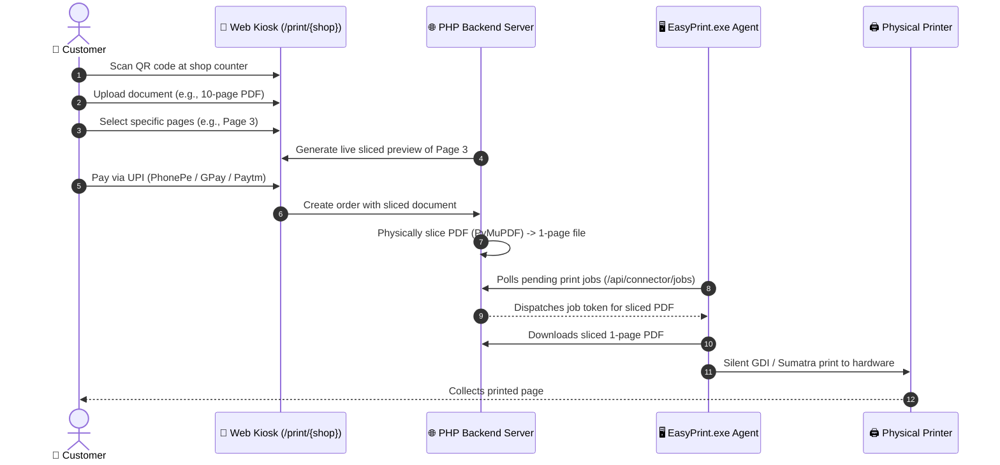

# 🖨️ EasyPrint — Automated Print Kiosk & Counter Spooler SaaS

[](https://php.net)
[](https://python.org)
[](https://tailwindcss.com)
[](LICENSE)

**EasyPrint** is a print counter automation SaaS tailored for photocopy centers, Xerox shops, cyber cafes, and stationery stores. Walk-in customers scan a counter QR code, upload documents (PDF, DOCX, Images), select custom pages with live preview, and pay directly to the shopkeeper's personal UPI with **0% platform fee**. The document automatically spools and prints on the shop's physical printer through a lightweight Windows background agent (`EasyPrint.exe`).

---

## 🚀 Key Features

### 📱 1. Zero-Login Customer Kiosk (Mobile-First Web App)
- **Instant Scan & Print**: Customers scan an A4 counter QR code with any smartphone camera — no app install or sign-up needed.
- **Multi-Format Upload**: Supports PDF, Microsoft Word (`.docx`), and images (`.png`, `.jpg`, `.jpeg`).
- **Custom Page Selection**: Select `All`, `Custom` (e.g. `1-5, 8`), `Odd pages only`, or `Even pages only`.
- **Live Document Preview**: Debounced server-side PyMuPDF slicing ensures the preview displays **only** the selected pages in real time.
- **Physical Server-Side Slicing**: Generates a dedicated slice containing only requested pages before sending to the printer, preventing wasted paper.
- **Direct 0% Commission UPI**: Instant UPI dynamic QR code + 1-click deep links (GPay, PhonePe, Paytm, BHIM) paying directly to the shopkeeper's VPA.

### 💻 2. Silent Windows Desktop Connector (`EasyPrint.exe`)
- **Zero-Dialog Silent Printing**: Automatically queues jobs and communicates with physical printers via Windows GDI / SumatraPDF.
- **Secure Machine Pairing**: Pair any Windows PC to a merchant shop account using a 6-digit rolling PIN.
- **Physical Slicer Safeguard**: Embedded PyMuPDF and win32print engines verify page ranges on physical spool.
- **System Tray Integration**: Runs discreetly in the Windows system tray with startup persistence.

### 📊 3. Merchant Dashboard & Management Console
- **Live Orders Stream**: Real-time polling with audio chimes for incoming jobs and instant status updates.
- **Dynamic Rate Matrix**: Customize per-page rates for A4/A3/Legal, B&W vs. Color, and Single-sided vs. Back-to-Back.
- **Printer & Device Management**: View installed physical printers, toggle default printer, and monitor online connectivity.
- **Printable A4 QR Posters**: Vector-grade printable counter poster ready to display in the shop.
- **SaaS Subscription Paywall**: Integrated Razorpay subscription handling for tiered shop subscriptions.

---

## 🛠️ Tech Stack & Architecture

- **Backend**: PHP 8.2 (Clean Native MVC architecture with router, middleware, and request/response abstraction)
- **Database**: SQLite (Zero-config local development) / MySQL 8.0 (Production ready)
- **Desktop Agent**: Python 3.13, PyMuPDF (`fitz`), `win32print`, `pystray`, `Pillow`, compiled via PyInstaller
- **Frontend**: Mobile-first responsive UI built with TailwindCSS, Material Symbols, and Plus Jakarta Sans
- **Payments**: Direct Indian UPI (NPCI Standard Specs) + Razorpay Subscription Gateway for merchants

---

## 📐 System Workflow



---

## 📂 Project Structure

```text
EasyPrint/
├── app/
│   ├── Core/                 # Router, Database, Auth, Request/Response, Session
│   ├── Http/
│   │   ├── Controllers/      # CustomerPortal, Dashboard, Auth, ConnectorApi, Billing
│   │   └── Middleware/       # AuthMiddleware, ApiAuth, SubscriptionPaywall
│   ├── Models/               # Order, DigitalDocument, PrintExecution, Shop, Printer
│   └── Services/             # DocumentParser, UpiService, RazorpayService
├── database/
│   ├── schema_sqlite.sql     # SQLite schema definitions
│   ├── seeders_sqlite.sql    # Default test seeds & plans
│   └── migrate.php           # Database migration CLI runner
├── desktop_connector/
│   ├── connector.py          # Python Windows print agent
│   ├── EasyPrint.spec        # PyInstaller build specification
│   ├── requirements.txt      # Python dependencies (fitz, win32print, pystray)
│   └── build.bat             # 1-click executable compiler
├── public/
│   ├── index.php             # Front controller
│   ├── js/customer-portal.js # Customer kiosk reactive logic
│   └── uploads/              # Storage directory for documents and logos
├── resources/
│   └── views/                # Views (auth, customer, dashboard, home, layouts)
├── routes/
│   ├── api.php               # Connector & kiosk API endpoints
│   └── web.php               # Public and dashboard web routes
├── scripts/
│   └── slice_pdf.py          # Standalone PDF slicer utility
├── artisan                   # EasyPrint CLI helper
├── composer.json             # PHP autoloader configuration
└── README.md
```

---

## ⚡ Quick Start & Installation

### 1. Prerequisites
- **PHP 8.2 or higher** with `pdo_sqlite`, `fileinfo`, `curl`, and `gd` extensions enabled.
- **Python 3.10+** (with `pip` and PyMuPDF installed).
- **Composer** (optional for autoloader regeneration).

### 2. Clone the Repository
```bash
git clone https://github.com/bhushanchavan04/EasyPrint.git
cd EasyPrint
```

### 3. Environment Configuration
Copy `.env.example` to `.env`:
```bash
copy .env.example .env
```
Default configuration uses SQLite:
```env
APP_NAME="EasyPrint SaaS"
APP_ENV=local
APP_DEBUG=true
APP_URL=http://localhost:8000
APP_SECRET=easyprint_super_secret_key_change_in_production_32char
DB_CONNECTION=sqlite
```

### 4. Run Database Migrations
Initialize the database tables and default subscription plans:
```bash
php artisan migrate
# or
php database/migrate.php
```

### 5. Start the Application Server
```bash
php -S 127.0.0.1:8000 -t public
```
Visit:
- **Landing Page**: `http://127.0.0.1:8000`
- **Merchant Login**: `http://127.0.0.1:8000/login`
- **Customer Print Kiosk**: `http://127.0.0.1:8000/print/{shopSlug}`

---

## 🖥️ Building the Desktop Connector

To compile `EasyPrint.exe` from source:

1. Install Python dependencies:
   ```bash
   cd desktop_connector
   pip install -r requirements.txt
   ```
2. Build standalone Windows binary using PyInstaller:
   ```bash
   pyinstaller --clean EasyPrint.spec
   ```
3. The compiled binary will be placed in `dist/EasyPrint.exe`.

---

## 🔒 Security & Data Privacy

- **Automatic Purging**: Uploaded customer documents are automatically purged after 24 hours.
- **Zero Interception**: Customer payments flow directly to the merchant's personal UPI; no customer banking data is stored.
- **HMAC Tokens**: Print job downloads between server and connector use time-limited HMAC-SHA256 signatures.

---

## 📄 License

This project is licensed under the [MIT License](LICENSE).
